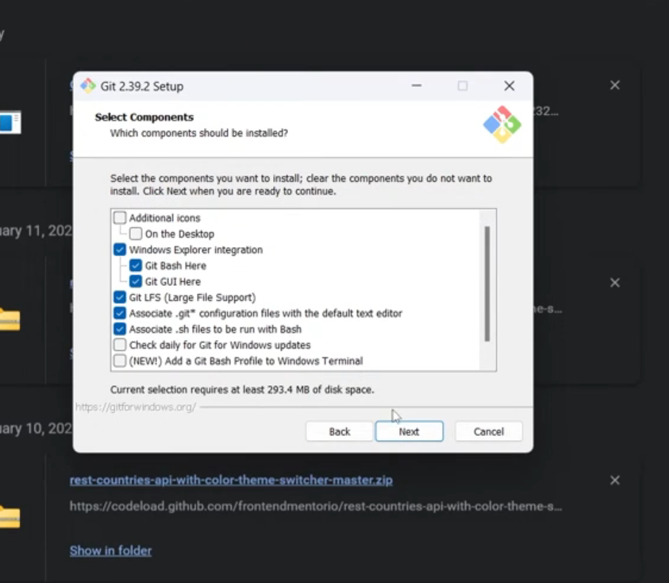

# Lecture 1

## key points
1. gui ek graphical interface hai jider hm interact krka perform kar skta h ok
2. same operation we can also perform via the command means via cli
cmd / wps / cloud shell / bash -> all are shell
cmd and wps based on window os
bash based on linux os
3. alg alg shell mai comand different hojti hai even for same work isi karan sai ek chij fixed h ki alg alg server's ka lya hm linux based shell ka hi use krga 
4. asa possible h ki kisis operation perform kerna k lya same comand ho per unska begavoire alg alg shell little bit so hm bash k respect mai hi sab chija explore krga bcz at the end to hmko servers k interact krna h islya usi ka uper ka krga ok kyu bakar kisis or k lya comands dekga ok
5. basicallt ager m overall bato to kuch asa h 
terminal ek software jsika under multiples software mtlb ki wo shells ok isko kuch iss tere smj lo ki ek borswer open krka different different tab mai website open krna 

## doubt
1. sir n bola ki terinal app hai ok or uska under multiple app run lrta h under app h powershell , bash shell ok per yha dono shell to alg al;g os per based and terminal jo allication wow kisi ek os per based hgoa right if yes to wo knsa os ha for terminal ok or fr wo ek inner app ko run , mananagr kr rha jabki woot kisi or os per based means parent os1 per based and uska children os2 per absed h to kesa parent children ko manage kr rha h ?????
2. cli koi ek common term hai , like gui ya cli el software ha mtlb ki terminal ek software h ok per to cli ek parent k for temrinal like asa kuch mtlb ki terminal k alva bhi cli hoti mtlb terminal ek cli application h to fr terminal k alva bhi cli applications hoti ya fr cli mtlb terminal hi hota h ????

# lecture 2

## key points
1. git install kya to pata chla ki git hmko kai sara componnets provide krta h ok like bash shell / git gui / git cmd etc
2. git ka gui k interface , not so good then i check a source code form it in github 
3. git ka use krka hm yha sab comand chla skta h but same chija or bhi sheels h una bhi krta h per git k jo main kam h wo yha nai h bcz git ek tool j ki build h version controll system per ok jiska help s hm log project k version k track rkta h and work ko manage kerta h individaully or team mai 
4. repositry ek databse k tere h but not truly , jider hmra code k version store and track hota h
5. unstaged area means current working directory measn jo abhi tak ya fr jo new kam kere h wo jisko abhi commit nai kera h wo idedr hota h but jesa hi staging area m add krta h iska matlb ki ek bhr frr s check krlo final commit s bcz fr riska bad git iska track rkga glti s extra ya glt chija to add nai hoga h
6. single file k trakc ya recod check krn a h to uska lya hm use krta h vs code k feature timeline (user 2 ticks milta h local history , git hisptory so basically we need for git so check git one is must)
7. if we want to see history for a file if we dont init git then time line with local hisotry

## doubts
1. 
yha kns kns component h or kiska kya sue ha 
2. vim name k ek edtitor h jisko git via defualt select rkta h [er mena select kya vscode to kya mtlb h iskam]
3. git cmd and git bash dono comonent ha ok to differnce kya ha
4. git jo ki software h wo knsa databse k use krta h kya mere sawal sai bhi h 
5. kai bhr -, -- use krta h per asa kyu or kabor kiska sath ok in command

# lecture 3
## key points
1. jab bhi hm log kerta h to hm milta h ek head krka basically iska kam hota h yha represent kerna ki abhi hm knsa branch mai h ya fr knsa commit mai h ok

# lecture 5
## key points
1. these all are gui application where we manage a repo kind of git repo
bitbucket (intergrable via jira)
github
gitlab

2. fast forwared merge 
- ismai merge commit nai ata h 
- jab commit history linear h to asa hota hai , 

# LECTURE 6 Revert and Reset Commits
## KEY POINTS 1
1. ager hamna glti s koi commit kr dya h to fr kesa mistake ko improve krga
2. yha cases ata h wo yha ki wo glt commit abhi tak local history mai ha ya fr remote
3. for local we use `reset` and for remote we use `revert`

## KEY POINTS 2 about all reset
1. reset k case m ye hmko teen flag options milta h like hard, moxed, soft 
2. but ager glti s reset kr dya h to fr kesa correct krga so yes we need to know coommit at which from we moved for that we can use git reflog then git reset sameflag commit_id
3. mtlb ki ager local tak simit h to yes we can delete , restore via using rest only and rest use a head for that restoreing concept

## key point 3 about head we see, how we can navigate
1. basically head attached hota h branch sa ok but we can ditached from it , can atached with particaluer commit_id, then hmra project wesa hoga jesa uss time us particluar commit id pai tha ok 
git checkout comit_id
2. or ager mai uss branch k jisper hm kam kr rha h usi pai cehckout krta hu to fr wo latest per jaker fr s attached hoga default ok
3. similar we can also naviage via using head simileraly like checkout
`git checkout head` - same commit per hoga but attached nai phl asa tha see
(head->main) , oer ab asa hoga (head,main) mtlb we need for headlocation 
`git checkout head~no.` , no. from 0 to +x,-x ok , from current location to bottom or top we can move.
current s top per jata h to then -x, 
current s bottom per jata h to then +x, 
current location always be a 0 ok,
this head concept we can also use in case of reset basically jider jider hm commit_id ki needs h uder uder hm yha head~no. wala concept use krsta h ok but yes ek chija yha bhi h rest use krna h for restore to uss commit id reflog s milga mtlb wo hma noraml log krna per nai aga to iss case m head~no. kesa bec wo abhi iss partucali log k part h n h because rest kar dya tha n

## KEY POINTS 4 about all revert
0. or ager lets suppsoe ki wo ek commit kisi or n developer n kya h but we can revert it , so no easy ok
1. jesa hi hm log bath kerta h remote ki to fr reset use n krta h bcz chances h history mismatch hona ki bcz ek project per multiple developers kam krta h pata chla ki kisis n fetch , merge kr lya eans pull and then frr hmna rest kra reomte pai to fr commit history missmatch hogi h ok to best pratice h ki remote k case m reset n use kro , revert use kro
2. 
- jisko kerna h revert uski id but rest k case m wo tha jisper move krna h ok,
- added new commit,
- jnsa commit id use kri h coomit id k time wala code jo add hua tha wo sab remove kr deta 
3. merged commit ko revert krna thoda different prcoess that we will be covered
4. if we want to revert a multiple commints then
- can use manualy one by one 
- can use in a range so we can proceed in one pass but jitna revert coomit hoga utna hi no. of revert commit banaga ok
`git revert head~num..head~num` 
 git revert olderCommit..latstCommit
            not included included
- but ager m chata hu ki ek hi rever msg bana to fr uska lya, ider asa 2 steps kyu bcz 1st step s wo sab code jo uss ranges m add haua tha wo sab stages area m ata h ok to fr continue krka hm pricedd krta h
`git revert -no--commit head~num..head~num` 
`git revert --containue head~num..head~num` 

### My doubts
`OUES - 1`
1- to revert a multiple commits in same containous manner we can do this via manually , ranges so we have a doubt for ranges ki ager ager m ranges dena k pattern oposite krdu to kya reqult bhi reverse hoga ??

`ANSWER -1`
- HEAD~n current commit se backward counting karta hai. Aur A..B mein A exclude aur B include hota hai. Isliye last 3 commits revert karne ke liye git revert HEAD~3..HEAD use karte hain.
Isliye first argument older aur second newer dena linear history mein generally convenient hota hai.

- Git range syntax A..B directional hai. Newer aur older ko reverse karne se Git automatically range reverse nahi karta. Agar tum git revert mein expected commits select karna chahte ho, toh older boundary first aur newer boundary second rakho.
- Aur ek baat: Ye explanation linear history ke liye hai. Merge commits aur branching history mein reachability ki wajah se range ka result aur complex ho sakta hai.

# lecture 7 how to Resolve Conflict in Git?
## learning 1  what an issue and then solution 
1. conflict kesa yes to basically ata h merg k time, 2 brachs h ok Ba, Bb ok or same file k same line per hmnak,uch change kere h or sath m commit bhi kr dya h to but jesa hi merge krga kisi ek m dusra to merge error aga wo bolga ki ab final knsa changes m hmko rkna h 
2. jiss branch ka under erge krhga uska show hoga `current change ` or jis branch ko merge kr rha h uska lya aga `incoming change` to inn dono ma s knsa final kerna h or sath hmko ek new section milga side pannael `merge changes` krka like `staged change` , `unstage change` kerka jesa milta h 2 sec eans total 3 hman deka h ab
3. knsa decide krna h uska 4 options milta h
- accept current change
- accept incoming change
- accept both change
- compare both

4. git add . (to move from merge changes to stages chamges)
5. git commit (default msg set ok) or git commit -m "msg"

6. same conflict we get via this also
ager kisi user n git pai push kar dya h kuch changes ok or meni bhi same fbrakch , same file same line pai changes kya h apna lock m or mai ager fetch merge mtlb pull krta hu to frr definalty same conflict milga ok to same process ha

## learning 2 when we are not ready , dont know about solution so abort concept
1. see ager conflict aha or mai merge kr rha tha ok to frr options milga ok jesa ki hmna phla deka h per ager we dont know ki knsa accept krna h chagnes , jiss developer n kra h wo avai;lable nai h to fr , kya kerea bcz hm abhi h mergeing mai h to hm kuch or kam nai slrta h to we can , abort mtlb ki abhi k lya chor iski bad dekga mtlb ki merge kr rha tha n to at kro or kuch kam krlo asa h 
`git merge --abort`

# all basics comand for terminal
----------------------------------------

  ls
  cd
  cd ../

  touch
  mkdir

  rm currentfilename/currentfoldername newname (to rename)

  rm filename1 foldernae filename2 ./location2 (location2 will br relative or absu both) (to move from one folder to another)

  rm filename
  rmdir foldername (if folder is empty)

  filename -> to run file (for others)
  start filename -> to run file in git bash

  .code (to open the vs code @ current working directory)
  pwd

  softwareName --version

----------------------------------------

# all basics comand for git (bash terminal)
----------------------------------------

 ## git comand 
 1.  git init
 2.  git add filename1 2 3 etc or git add . (knsa file track kerni hai uska lya unn sab file ko staging area m add krna hoti means like stanging area mai move kerna from unstaged area )
 3. git status
 5. git commit -m "commit message here"
 6. 
 7. git config --global user.key (to get)
 8. git config --global user.key "value" (to sett) (part of configuration) (name and email needs to configure)
 9. git log (to see all commits , fro here we get commit_id)
 10. git checkout commit_id
 11. git branch branchName
 12. git branch (to log all branchs)
 13. git branh -d branchName
 14. git checkout branchName (to enter into that brnach)
 15. git merge branchName (jiski kerna ) , (jiska under kerna h uss branch m hona ust h ok)
     git merge --abort 
 16. git push -u origin main
 
 17. git fetch and then git merge -> git pull (automatcaaaly do fast forwared ok)

 18. git reset flag (commit_id or head~NO.) (id at which location we want)

 19. git reflog (removed commit bhi visible hota h)  , lets we get commit id3 okthen
     git reset that sameFlag id3

 20. git revert commit_id (jis commit ko revert krna h uska commit id ok)
     git revert head~num..head~num 
                older     latest   (if we want to revert multiple commit + utna hi revert commit banaga jitna range m gai h ok or also we can do sepreatrely manualy)

 ## git flags or comand line options
 1. -s (short m diplay kerta h)

 2. --all
 3. --oneline
 4. --graph
 5. --decorate

 6. -u to set upstream ok

 7. -D,-d to delete branch

 8. --hard (code reset + commit histoery remove)
 9. --soft (no code reset means code still present in  file but stages area m ajta h means ager hm manuly unstaged krda to fr remove hojta h code ok + commit histoery remove)
 10. --mixed (by defult) (code histpery removed ok + but code still present but wo unstaged area m ata h before wala case stages area m ata h so we can chnage it manually )

 11. -no--commit (no commit, ek hi commit mai sab revert cover krdo but actualy mai sab ko staged area m lkr ata h then continue kr skta h means ki totlay hta do prcoedd krna h aga ya fr jesa tha phla wesa krdo usko lya abort h)
 12. --abort
 13. --containue

 14. --abort (to cancle merging because conflict we have , dont know which we need to select, and we want work other but on same project)

 `Note`
 Har short option ka long equivalent available nahi hota aur har long option ka short equivalent bhi nahi hota.

 Short aur Long options command-line arguments ke do formats hain. Dono ka one-to-one mapping hona zaroori nahi hai. Git developers har option ke liye short alias provide karein, ye mandatory nahi hai.

 `Note`
 1. cntl + shift + p
 git comamnd pilot open hota h 
 i used it for a git lens graph

